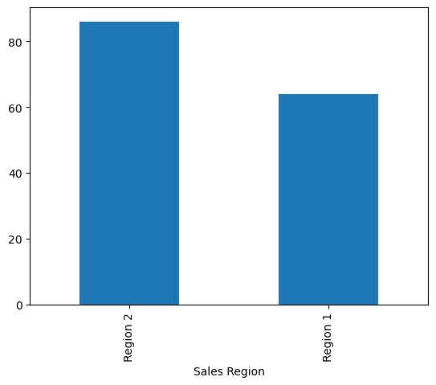
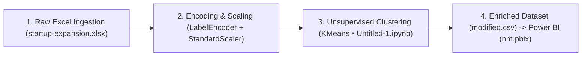

# Startup Expansion Analysis (`Startup-Expansion-Analysis-`) — K-Means Clustering & Power BI

## Table of Contents
- [Executive Summary & Business Utility](#executive-summary--business-utility)
- [Visual Showcase (UI & Dashboards)](#visual-showcase-ui--dashboards)
- [System Architecture & Layers](#system-architecture--layers)
- [Data Model & Feature Schema](#data-model--feature-schema)
- [Analytical Pipeline & Modules](#analytical-pipeline--modules)
- [Getting Started](#getting-started)
- [Business Value, ROI & Growth Opportunities](#business-value-roi--growth-opportunities)

---

## Executive Summary & Business Utility
`Startup-Expansion-Analysis-` combines **unsupervised machine learning (`KMeans` clustering in Python)** with an **interactive Power BI executive report (`nm.pbix`)** to evaluate 150 store/branch expansion records (`startup-expansion.xlsx` -> `modified.csv`). It enables founders, retail strategists, and investors to segment markets by marketing spend, revenue, ROI, profit, and Return on Marketing Spend (`Roms %`) before committing expansion capital.

---

## Visual Showcase (UI & Dashboards)
Clustering & exploratory visualization extracted from `Untitled-1.ipynb`:



---

## System Architecture & Layers


| Layer | Tools & Artifacts |
| :--- | :--- |
| **Data Ingestion & Prep** | `pandas`, `numpy`, `LabelEncoder`, `StandardScaler` (`startup-expansion.xlsx`) |
| **Unsupervised ML Layer** | `sklearn.cluster.KMeans` market segmentation (`Untitled-1.ipynb`, 19 cells) |
| **Visualization & BI Layer** | `matplotlib`, `seaborn`, and Power BI (`nm.pbix`, `modified.csv`) |

---

## Data Model & Feature Schema
- **Processed Dataset**: `modified.csv` (**150 stores/markets**)
- **Columns**: `Store ID`, `City`, `State`, `Sales Region`, `New Expansion`, `Marketing Spend`, `Revenue`, `Roi`, `profit`, `Roms`, `Roms %`

---

## Analytical Pipeline & Modules
1. Load `startup-expansion.xlsx` and engineer profitability/ROI metrics (`Roi`, `profit`, `Roms`, `Roms %`).
2. Encode categorical region/expansion indicators and standardize numerical features.
3. Segment branches via `KMeans` clustering and export `modified.csv` for Power BI storytelling (`nm.pbix`).

---

## Getting Started
```bash
git clone https://github.com/islamsamyy/Startup-Expansion-Analysis-.git
cd Startup-Expansion-Analysis-
jupyter notebook Untitled-1.ipynb
```
*(Open `nm.pbix` in Power BI Desktop to explore the interactive executive report.)*

---

## Business Value, ROI & Growth Opportunities
- **Data-Driven Capital Allocation**: Prevents burning expansion budgets in low-ROMs territories by separating high-ROI growth clusters from saturated markets.
- **Franchise Territory Scoring SaaS**: Combine this clustering workflow with live demographic and foot-traffic APIs to sell automated site-selection scoring to retail and F&B chains.
